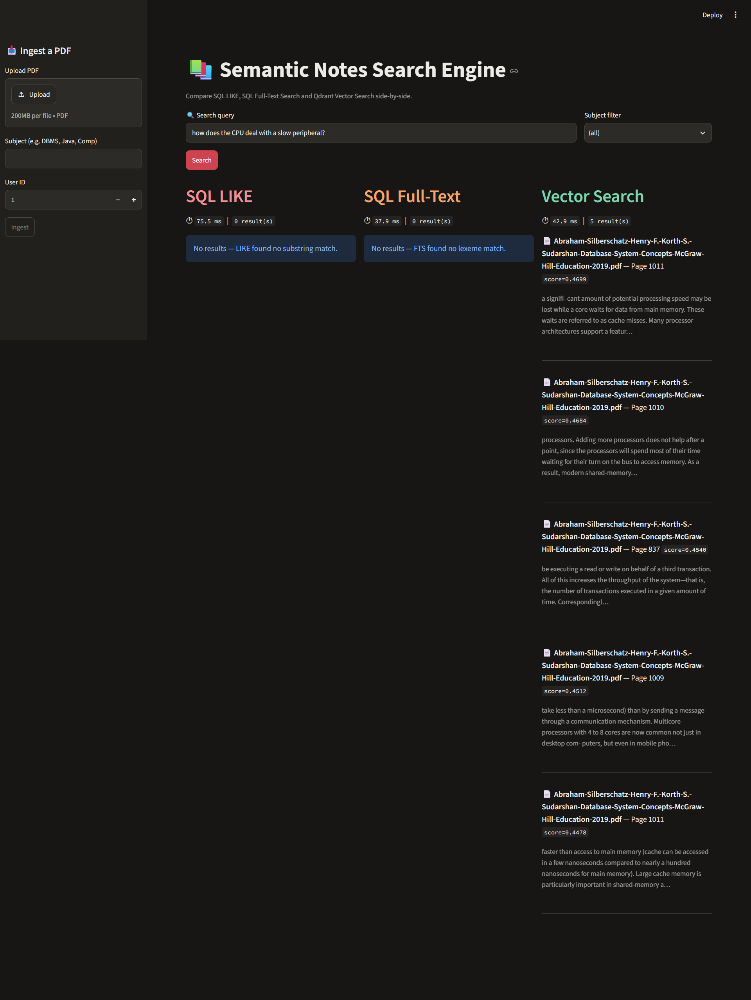

# Semantic Notes Search Engine

**Vector Database vs Relational Database: when to use which**

A DBMS case study. Students upload PDF notes and search them by meaning. The same query is run on three searches side by side:

| Search | Database feature | Finds |
|---|---|---|
| SQL `LIKE` | full table scan | exact text only |
| SQL full-text search | GIN index on `tsvector` | words and word forms |
| Vector search | Qdrant HNSW index, cosine distance | meaning |

No LLM is used. The focus is database design, indexing, consistency and benchmarking.



---
## Tech stack

| Layer               | Technology                                                                         |
| ------------------- | ---------------------------------------------------------------------------------- |
| Language            | Python 3.10+                                                                       |
| Relational database | PostgreSQL 15 (B-tree index, GIN full-text index), driver psycopg2-binary          |
| Vector database     | Qdrant (HNSW index, cosine distance, payload filtering), qdrant-client over gRPC   |
| Embeddings          | sentence-transformers, model all-MiniLM-L6-v2 (384 dimensions), runs locally       |
| PDF parsing         | pypdf                                                                              |
| Frontend            | Streamlit                                                                          |
| Benchmarking        | pandas, matplotlib                                                                 |
| Infrastructure      | Docker Compose (PostgreSQL and Qdrant containers), python-dotenv for configuration |
## Architecture (polyglot persistence)


- **PostgreSQL** stores users, documents, chunks and ingestion jobs, plus a B-tree index on `documents(subject)` and a GIN index for full-text search.
- **Qdrant** stores one vector per chunk. Cosine distance, HNSW `m=16`, `ef_construct=100`. Payload: `doc_id`, `subject`, `chunk_index`, `text`.
- **Link between them:** the Qdrant point ID is the same UUID as `chunks.chunk_id`.

### Consistency between the two databases
One transaction cannot cover both databases, so ingestion works like this:

1. Save the document, chunks and a `PENDING` row in `ingestion_jobs` (Postgres).
2. Upsert the vectors into Qdrant.
3. Mark the job `COMPLETED`.

If step 2 fails, the job stays `PENDING` and `database/retry_worker.py` re-sends it. The upsert is idempotent because the point ID equals `chunk_id`, so a retry cannot create duplicates. This is eventual consistency with a simple outbox-style retry. A background worker is not built; the retry is run manually.

---

## Project structure

```
database/    schema, Qdrant setup, retry worker, failure-recovery test
src/         ingest.py, search_sql.py, search_vector.py
benchmark/   dataset builder, benchmark runner, query check, questions evaluator, results/
docs/        EXPLAIN evidence, screenshots
app.py       Streamlit demo
docker-compose.yml
```

---

## Setup

Requirements: Docker Desktop, Python 3.10+.
```powershell
# 1. Start PostgreSQL and Qdrant
docker compose up -d

# 2. Create your environment file and fill in the values
cp .env.example .env        # Windows: copy .env.example .env

# 3. Install dependencies
pip install -r requirements.txt

# 4. Create tables and indexes (PowerShell, run once on a new database)
Get-Content database/postgres_schema.sql -Raw | docker compose exec -T postgres psql -U admin -d notes_db
Get-Content database/001_add_chunks_page_no.sql -Raw | docker compose exec -T postgres psql -U admin -d notes_db
Get-Content database/002_add_ingestion_retry_count.sql -Raw | docker compose exec -T postgres psql -U admin -d notes_db
 
# 5. Create the Qdrant collection
python database/qdrant_setup.py
```

Put your own PDFs under `data/<subject>/`, for example `data/dbms/`.
The Silberschatz textbook *Database System Concepts*, used in the experiments, is **not included** in this repository for copyright reasons.

### Environment variables (`.env`)
See `.env.example`. Never commit `.env`.

| Variable | Meaning |
|---|---|
| `POSTGRES_URL` | PostgreSQL connection string |
| `QDRANT_URL` | Qdrant URL, for example `http://localhost:6333` |
| `QDRANT_API_KEY` | Optional, for Qdrant Cloud |

---

## Run

```bash
# Demo app (upload PDFs in the sidebar, search in the main area)
streamlit run app.py
```

| Task | Command |
|---|---|
| Ingest a PDF | use the app sidebar, or call `ingest_pdf(path, subject, user_id)` from `src/ingest.py` |
| Retry failed ingestion jobs | `python database/retry_worker.py` |
| Failure-recovery proof | `python database/test_failure_recovery.py "<small.pdf>"`, then `--cleanup` |
| Build 1k, 10k, 50k datasets | `python benchmark/generate_data.py` |
| Check query keywords exist | `python benchmark/check_queries.py` |
| Full benchmark | `python benchmark/run_benchmarks.py` (use `--quick` for a short test) |
| gRPC vs HTTP experiment | `python benchmark/run_qdrant_tuning.py` |
| Questions evaluation | `python benchmark/evaluate_questions.py` |

Results are written to `benchmark/results/`. All numbers below come from those files.

---

## Results

Test machine and library versions are in `benchmark/results/environment.txt`.
Datasets of 1,000, 10,000 and 50,000 chunks. The real note pool has 8,452 chunks; larger sizes are padded by repeating real chunks.

### 1. Keyword search scaling (p50 latency, count queries so every row is scanned)

| Size | LIKE (full scan) | Full-text (GIN) |
|---|---|---|
| 1k | 3.55 ms | 0.37 ms |
| 10k | 28.36 ms | 0.41 ms |
| 50k | 135.59 ms | 0.56 ms |

`LIKE '%word%'` cannot use a B-tree index, so it reads every row and grows roughly linearly with data size. The GIN index stays almost flat. Query plans are in `docs/explain_evidence.txt`.

### 2. Vector search: HNSW vs exact, and gRPC vs HTTP (client-side p50)

| Size | Exact, HTTP | Exact, gRPC | HNSW ef16, gRPC |
|---|---|---|---|
| 1k | 12.5 to 15.9 ms | 1.93 ms | 1.81 ms |
| 10k | 10.6 to 17.2 ms | 4.38 ms | 4.26 ms |
| 50k | 15.5 to 20.8 ms | 5.86 ms | 2.99 ms |

- Most of the earlier Qdrant latency was HTTP overhead. gRPC was about 3x to 8x faster.
- HNSW showed no clear advantage at 1k and 10k. It was about 2x faster than exact search only at 50k.
- Recall@5 was 1.0 at source level everywhere. At point level, HNSW with `ef=16` scored 0.95 at 50k, the only value below 1.0. This is the latency vs recall trade-off.
- Full numbers: `benchmark/results/results.csv` and `qdrant_tuning.csv`. Graphs: `latency_vs_size.png`, `recall_vs_latency.png`.

### 3. Search by meaning (5 hand-labelled paraphrase questions)

| Method | Correct page in top 5 |
|---|---|
| SQL LIKE | 0 of 5 |
| SQL full-text | 0 of 5 |
| Vector search | 2 of 5 |
| Vector + subject filter | 4 of 5 |

The subject filter (Qdrant payload filtering) helped because the large textbook outranked the smaller class notes for non-DBMS questions.

### Index and load times (`benchmark/results/dataset_build.csv`)

| Size | Postgres load | GIN build | Qdrant upload |
|---|---|---|---|
| 1k | 0.09 s | 0.09 s | 0.17 to 0.23 s |
| 10k | 0.33 to 0.44 s | 0.62 to 0.63 s | 2.4 to 2.8 s |
| 50k | 1.54 s | 3.02 s | 11.9 s |

Qdrant reported the HNSW index ready within one 2-second polling interval after upload at every size, so the true wait is below about 2 s and was not measured more finely.

---

## Limitations

- The 10k and 50k sets are padded by repeating real chunks (about 83% of the 50k set), so recall is only a rough measure.
- Only 5 of 20 questions have hand-labelled ground truth, so the questions table is a small demo, not an accuracy figure.
- LIKE and full-text score 0 on paraphrases partly by construction: natural-language questions rarely contain the exact words, and `plainto_tsquery` requires every word to match.
- Qdrant timings are client-side. Server-side time was not available from the client API.
- At these sizes brute-force search is already cheap. HNSW is expected to pay off at much larger scale; this project does not test that.
- The retry worker is run manually, not as a background service.

---

## When not to use a vector database

- When users search for exact terms, codes or names, a full-text index is faster and exact.
- When the data is small, exact search is cheap and simpler.
- When you need strict transactions across the data, a relational database is the better fit.

A practical design uses both: keyword search for exact matches, vector search for meaning, and metadata filters to narrow results.


---

## Team

Nandhitha Ratan (160625733053)
Shikha Maity (160625733060)
Under the guidance of 
Dr. P.R. Anisha 
(associate professor, SCETW)
## References

- Malkov, Y. and Yashunin, D., *Efficient and robust approximate nearest neighbor search using Hierarchical Navigable Small World graphs* (verify the citation details on Google Scholar).
- PostgreSQL documentation: full-text search and GIN indexes.
- Qdrant documentation: HNSW indexing and payload filtering.
